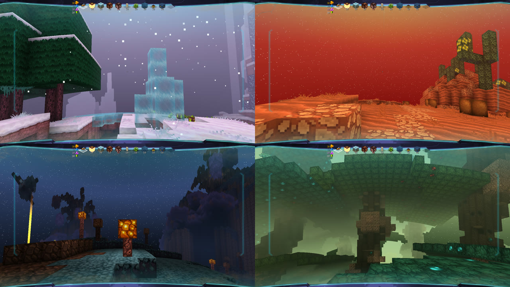
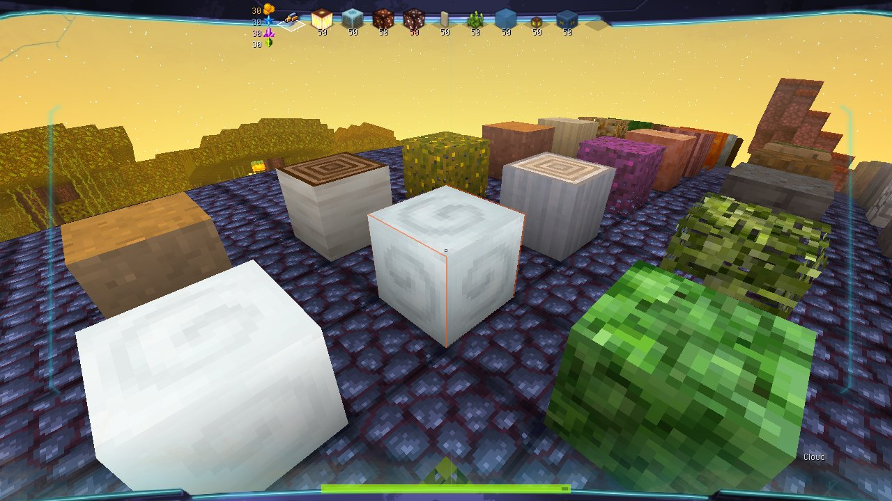
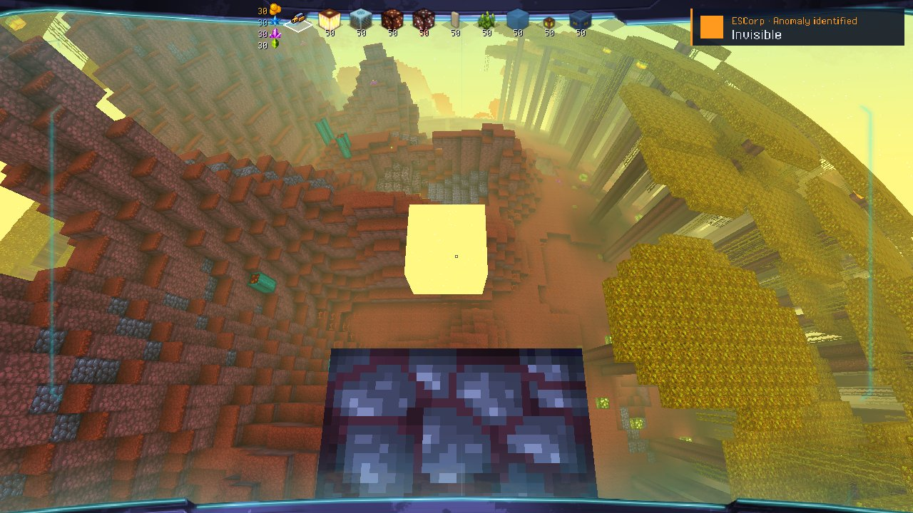
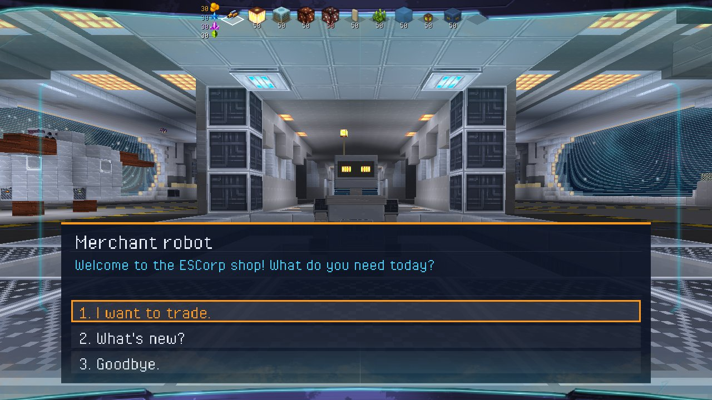
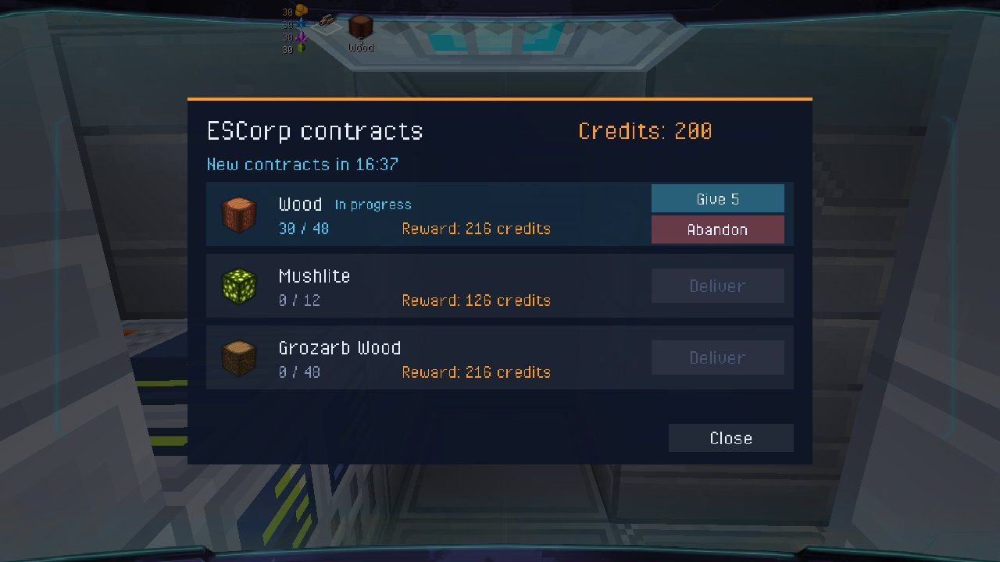

# Galaxy 55 — offline version (native Windows port)

**English** · [Español](#español) · [Français](#français)



**Galaxy 55** was a Flash web game (2012) by **Motion Twin**: space exploration, randomly generated planets and a 3D block-building and crafting system.
It was shut down and its server no longer exists. This project ports it to a **native Windows desktop application**
(Haxe 4 + Heaps + HashLink), with no Flash and no server, starting from the code Motion Twin published in
[WebGamesArchives](https://github.com/motion-twin/WebGamesArchives). The goal is to stay faithful to the original; anything we add is labelled as such.

> Work in progress, not a final version.

## Where to find things

| I want to… | Look at |
|---|---|
| **Play without compiling** | [pre-release v0.8](../../releases/tag/v0.8): download the zip, unzip it, run `jugar.bat` |
| **Controls and how to build** | [`port/README.md`](port/README.md) |
| **See or report bugs** | [`BUGS.md`](BUGS.md) (known bugs); to report a new one, open an *issue* or message me |
| **See what is missing** | [`TODO.md`](TODO.md) (to-do list) |
| **Ideas for later** | [`IDEAS.en.md`](IDEAS.en.md) (nothing decided yet) |
| **See what changed** | [`CHANGELOG.en.md`](CHANGELOG.en.md) |
| **Developer notes** | [`port/RESUMEN.md`](port/RESUMEN.md) (Spanish) |
| **The Flash version (archived)** | [`docs/flash/README_flash.md`](docs/flash/README_flash.md) (Spanish, English summary at the end), branch [`flash`](../../tree/flash), tag [`flash-version`](../../tree/flash-version) |

## Play in 3 steps

1. Download the zip from the [pre-release v0.8](../../releases/tag/v0.8) and **unzip everything** (keep all its folders).
2. Check that there is a **`res/`** folder next to `galaxy55.hl` (with `texture.png`, `lazer.png`… inside). If you see loose files named
   like `res\texture.png` instead, extraction failed: unzip again with a different program. (Symptom: `Can't read res/texture.png`.)
3. Windows: double-click `jugar.bat` (if it doesn't open, `jugar_dx.bat`). **Linux / macOS (not tested by us):** download the `galaxy55-offline-v0.8-linux-mac.zip` from the release,
   install [HashLink](https://github.com/HaxeFoundation/hashlink) (`brew install hashlink` on macOS) and run `sh jugar.sh`. (A player got it running on Linux; tell us how it goes.)
   The language (Spanish, English, French), VSync and the FPS limit are changed in Options.

## New in v0.8

Almost all of it by **Cornor923**: the 77 **kubes of Kube** (Motion Twin, 2010) as game blocks, the **invisible anomaly**
(a cube you only see as a piece of sky, with Kube chests and gems inside, and coloured toughened glass), the **mothership
shop** in the middle of the hangar where you talk to the merchant robot, and **ESCorp contracts in parts**. Also more
generous synthesizer recipes, fairer merchant prices and smooth block icons. Details in the
[release notes](../../releases/tag/v0.8) and the [`CHANGELOG.en.md`](CHANGELOG.en.md).

<p>


</p>
<p>


</p>

v0.7 brought the ESCorp database, comets, exploration licenses and the kube editor
([release notes](../../releases/tag/v0.7)).

## What works today


Start menu, saved games, planets identical to the original ones (verified by hash against Flash), digging and placing blocks, jetpack,
creative mode (our addition), the ship with its teleporter, doors, synthesizer with the original recipes and the on-board computer
(from which you can also pilot the ship over the planet and take ESCorp contracts, our additions),
the **hangar** to rebuild your ship, **sound**, **flowing water** (the original's), and the **star map** (sector, solar systems,
scanning, landing, GPS arrows) with the **merchant robot**: follow it, dock and trade in its ship.


Also health and oxygen (falls, lava, drowning) and the original's water waves. Still to do: give space travel more depth
(fuel and other ideas in [`IDEAS.en.md`](IDEAS.en.md)) and a quality option for slow PCs. See [`TODO.md`](TODO.md).

## Known bugs (summary)

Full numbered list in [`BUGS.md`](BUGS.md). The main ones:
- Light on partial blocks (plates, iron, chests): fixed like the original, to be checked while playing.
- Spruce leaves drop material; dropped crystals look too wide.

**Found another one?** Tell me in a GitHub *issue* or on Discord, with what you were doing and a screenshot if you can.

## Repository layout

```
port/           THE NATIVE PORT (active work)
  game/         the game        explore/  star map     shim/  flash.* compatibility layer for the original generators
  headless/     verification    dev/      test bench   LEEME.md, RESUMEN.md, RELEASE.md, jugar.bat
docs/flash/     documentation of the Flash version (README, changelog, to-do of that time)
docs/           research notes (sources, Twinpedia, Discord);  docs/img/  screenshots
src/ libs/ stubs/ tools/ data/   original (Motion Twin) code the port compiles, and its tools
                (the Flash build files and SWFs are in the `flash` branch)
```

## License and credits

The original code, graphics and data belong to **Motion Twin** and were published under
[CC BY-NC-SA 4.0](https://creativecommons.org/licenses/by-nc-sa/4.0/). This modified version is shared under the **same license**:
non-commercial, with credit to Motion Twin, share-alike. It is not affiliated with or endorsed by Motion Twin.
Thanks to the Eternaltwin community for preserving documentation and screenshots.
Thanks to **Sekhmet** for detailed bug reports, testing on Linux, and memories of how the original game worked (water, lava, cascades).
Thanks to **Cornor923** for the French README and fixes (liquid veil on wide windows, ice faces, the head clipping into blocks, launcher without console, bedrock layer, main menu on wide windows, creative palette and oxygen, death and damage in the ship and hangar, mothership saves and play time, the ship on the star map).

---

## Español

**Galaxy 55** fue un juego web de Flash (2012) de **Motion Twin**: exploración espacial, planetas generados al azar y
un sistema de bloques con crafteo en 3D. Se cerró y su servidor ya no existe. Este proyecto lo porta a una
**aplicación de escritorio nativa para Windows** (Haxe 4 + Heaps + HashLink), sin Flash y sin servidor, partiendo del
código que Motion Twin publicó en [WebGamesArchives](https://github.com/motion-twin/WebGamesArchives).
El objetivo es ser fiel al original; lo que añadimos está marcado como tal.

> Es un trabajo en curso, no una versión final.

### Dónde está cada cosa

| Quiero… | Mira |
|---|---|
| **Jugar sin compilar** | [pre-release v0.8](../../releases/tag/v0.8): descarga el zip, descomprímelo y abre `jugar.bat` |
| **Controles y cómo compilar** | [`port/LEEME.md`](port/LEEME.md) |
| **Ver o avisar de errores** | [`ERRORES.md`](ERRORES.md); para avisar de uno nuevo, abre un *issue* o escríbeme |
| **Saber qué falta por hacer** | [`PENDIENTES.md`](PENDIENTES.md) |
| **Ideas para más adelante** | [`IDEAS.md`](IDEAS.md) (nada decidido todavía) |
| **Ver qué cambió** | [`CHANGELOG.md`](CHANGELOG.md) |
| **Notas técnicas del desarrollo** | [`port/RESUMEN.md`](port/RESUMEN.md) |
| **La versión Flash (archivada)** | [`docs/flash/README_flash.md`](docs/flash/README_flash.md), rama [`flash`](../../tree/flash), etiqueta [`flash-version`](../../tree/flash-version) |

### Jugar en 3 pasos

1. Descarga el zip de la [pre-release v0.8](../../releases/tag/v0.8) y **descomprímelo entero** (con todas sus carpetas).
2. Comprueba que hay una carpeta **`res/`** junto a `galaxy55.hl` (con `texture.png`, `lazer.png`… dentro). Si en vez de eso ves
   archivos sueltos llamados `res\texture.png`, la extracción falló: vuelve a descomprimir con otro programa. (Síntoma: `Can't read res/texture.png`.)
3. Windows: doble clic en `jugar.bat` (si no abre, `jugar_dx.bat`). **Linux / macOS (sin probar por nosotros):** descarga `galaxy55-offline-v0.8-linux-mac.zip` de la release,
   instala [HashLink](https://github.com/HaxeFoundation/hashlink) (`brew install hashlink` en macOS) y ejecuta `sh jugar.sh`. (Un jugador lo ha hecho funcionar en Linux; cuéntanos qué tal.)
   El idioma (español, inglés, francés), la sincronización vertical (VSync) y el límite de FPS se cambian en Opciones.

### Novedades de la v0.8

Casi todo de **Cornor923**: los 77 **kubes de Kube** (Motion Twin, 2010) como bloques del juego, la **anomalía invisible**
(un cubo que solo se ve como un trozo de cielo, con cofres de Kube y gemas dentro, y los vidrios blindados de color), la
**tienda de la nave nodriza** en el centro del hangar, donde se habla con el robot comerciante, y los **contratos de la
ESCorp por partes**. También recetas del sintetizador que dan más, precios del robot más justos e iconos de bloques lisos.
Detalles en las [notas de la release](../../releases/tag/v0.8) y el [`CHANGELOG.md`](CHANGELOG.md).

<p>


</p>
<p>


</p>

La v0.7 trajo la base de datos ESCorp, los cometas, las licencias de exploración y el editor de kubes
([notas de la release](../../releases/tag/v0.7)).

### Qué funciona hoy

Menú de inicio, partidas guardadas, planetas idénticos a los del original (verificado por hash contra Flash),
excavar y colocar, jetpack, modo creativo (añadido nuestro), la nave con teletransportador, puertas, sintetizador con las
recetas del original y ordenador de a bordo (desde el que también se pilota la nave sobre el planeta y se cumplen contratos de la ESCorp, añadidos nuestros), el **hangar** para rehacer tu nave, el **sonido**, el **agua que fluye** (la del
original) y el **mapa de estrellas** (sector, sistemas solares, escaneo, aterrizaje, flechas GPS) con el **robot comerciante**:
lo sigues, te acoplas y comercias en su nave. También la vida y el oxígeno (caídas, lava, ahogarse) y las olas del agua del
original. Falta dar más profundidad al viaje espacial (combustible y otras ideas en [`IDEAS.md`](IDEAS.md)) y una opción de
calidad para PC lentas; ver [`PENDIENTES.md`](PENDIENTES.md).

### Errores conocidos (resumen)

Lista completa y numerada en [`ERRORES.md`](ERRORES.md). Los principales:
- Luz de los bloques parciales (placas, hierro, cofres): arreglada como el original, falta comprobarla jugando.
- Las hojas del abeto sueltan material; los cristales sueltos se ven demasiado anchos.

**¿Has encontrado otro?** Cuéntalo en un *issue* de GitHub o por Discord, con lo que hacías y una captura si puedes.

### Estructura del repositorio

Ver el esquema en inglés más arriba: `port/` es el port nativo (activo); `docs/flash/` la documentación de la versión Flash;
`docs/` las notas de investigación y `docs/img/` las capturas; el resto (`src/`, `libs/`, `stubs/`…) es el código original que compila el port; lo que solo servía para compilar la versión Flash (y sus SWF) está en la rama `flash`.

### Licencia y créditos

El código, los gráficos y los datos originales son de **Motion Twin**, publicados bajo
[CC BY-NC-SA 4.0](https://creativecommons.org/licenses/by-nc-sa/4.0/). Esta versión modificada se comparte bajo la
**misma licencia**: sin uso comercial, con atribución a Motion Twin y compartiendo igual. No está afiliada ni respaldada
por Motion Twin. Gracias a la comunidad de Eternaltwin por conservar documentación y capturas.
Gracias a **Sekhmet** por sus reportes de errores detallados, las pruebas en Linux y sus recuerdos de cómo funcionaba el juego original (agua, lava, cascadas).
Gracias a **Cornor923** por el README en francés y sus arreglos (velo del agua en ventanas anchas, caras del hielo, la cabeza que se metía en los bloques, lanzador sin consola, la capa de roca madre, el menú principal en ventanas anchas, la paleta y el oxígeno del creativo, la muerte y el daño en la nave y el hangar, el guardado y el tiempo de juego en la nave nodriza, la nave en el mapa de estrellas).

---

## Français

**Galaxy 55** était un jeu web en Flash (2012) de **Motion Twin** : exploration spatiale, planètes générées aléatoirement et
système de construction en blocs avec artisanat en 3D. Il a fermé et son serveur n'existe plus. Ce projet le porte en
**application de bureau native pour Windows** (Haxe 4 + Heaps + HashLink), sans Flash ni serveur, à partir du code que
Motion Twin a publié dans [WebGamesArchives](https://github.com/motion-twin/WebGamesArchives).
L'objectif est de rester fidèle à l'original ; ce que nous ajoutons est signalé comme tel.

> Travail en cours, pas une version finale.

### Où trouver quoi

| Je veux… | Voir |
|---|---|
| **Jouer sans compiler** | [pré-version v0.8](../../releases/tag/v0.8) : télécharge le zip, décompresse-le et lance `jugar.bat` |
| **Les commandes et la compilation** | [`port/LISEZMOI.md`](port/LISEZMOI.md) |
| **Voir ou signaler des bugs** | [`BUGS.fr.md`](BUGS.fr.md) (bugs connus) ; pour en signaler un nouveau, ouvre une *issue* ou écris-moi |
| **Voir ce qui manque** | [`TODO.fr.md`](TODO.fr.md) (liste des tâches) |
| **Des idées pour plus tard** | [`IDEAS.fr.md`](IDEAS.fr.md) (rien n'est encore décidé) |
| **Voir ce qui a changé** | [`CHANGELOG.fr.md`](CHANGELOG.fr.md) |
| **Notes techniques du développement** | [`port/RESUMEN.md`](port/RESUMEN.md) (en espagnol) |
| **La version Flash (archivée)** | [`docs/flash/README_flash.md`](docs/flash/README_flash.md) (en espagnol, résumé en anglais à la fin), branche [`flash`](../../tree/flash), tag [`flash-version`](../../tree/flash-version) |

### Jouer en 3 étapes

1. Télécharge le zip de la [pré-version v0.8](../../releases/tag/v0.8) et **décompresse-le entièrement** (avec tous ses dossiers).
2. Vérifie qu'il y a un dossier **`res/`** à côté de `galaxy55.hl` (avec `texture.png`, `lazer.png`… dedans). Si tu vois à la place
   des fichiers isolés nommés `res\texture.png`, l'extraction a échoué : décompresse à nouveau avec un autre programme. (Symptôme : `Can't read res/texture.png`.)
3. Windows : double-clic sur `jugar.bat` (s'il ne s'ouvre pas, `jugar_dx.bat`). **Linux / macOS (non testé par nous) :** télécharge `galaxy55-offline-v0.8-linux-mac.zip` depuis la release,
   installe [HashLink](https://github.com/HaxeFoundation/hashlink) (`brew install hashlink` sur macOS) et lance `sh jugar.sh`. (Un joueur l'a fait fonctionner sous Linux ; dis-nous comment ça se passe.)
   La langue (espagnol, anglais, français), la synchronisation verticale (VSync) et la limite d'images par seconde se changent dans les Options.

### Nouveautés de la v0.8

Presque tout de **Cornor923** : les 77 **kubes de Kube** (Motion Twin, 2010) en blocs du jeu, l'**anomalie invisible** (un
cube qu'on ne voit que comme un morceau de ciel, avec des coffres de Kube et des gemmes dedans, et les vitres blindées de
couleur), la **boutique du vaisseau-mère** au milieu du hangar, où l'on parle au robot marchand, et les **contrats ESCorp en
plusieurs fois**. Aussi des recettes du synthétiseur plus généreuses, des prix du robot plus justes et des icônes de blocs
lisses. Détails dans les [notes de la version](../../releases/tag/v0.8) et le [`CHANGELOG.fr.md`](CHANGELOG.fr.md).

<p>


</p>
<p>


</p>

La v0.7 a apporté la base de données ESCorp, les comètes, les licences d'exploration et l'éditeur de Kubes
([notes de la version](../../releases/tag/v0.7)).

### Ce qui fonctionne aujourd'hui

Menu de démarrage, parties sauvegardées, planètes identiques à celles de l'original (vérifié par empreinte face à la version Flash),
creuser et poser des blocs, jetpack, mode créatif (notre ajout), le vaisseau avec son téléporteur, les portes, le synthétiseur avec
les recettes d'origine et l'ordinateur de bord (d'où l'on pilote aussi le vaisseau au-dessus de la planète et remplit des contrats ESCorp, nos ajouts), le **hangar** pour refaire ton vaisseau, le **son**, l'**eau qui s'écoule** (celle
de l'original) et la **carte stellaire** (secteur, systèmes solaires, scan, atterrissage, flèches GPS) avec le **robot marchand** :
tu le suis, tu t'amarres et tu fais du commerce dans son vaisseau. Aussi la vie et l'oxygène (chutes, lave, noyade) et les
vagues de l'eau de l'original. Il reste à donner plus de profondeur au voyage spatial (carburant et autres idées dans
[`IDEAS.fr.md`](IDEAS.fr.md)) et une option de qualité pour les PC lents ; voir [`TODO.fr.md`](TODO.fr.md).

### Bugs connus (résumé)

Liste complète et numérotée dans [`BUGS.fr.md`](BUGS.fr.md). Les principaux :
- Lumière des blocs partiels (plaques, fer, coffres) : corrigée comme l'original, à vérifier en jouant.
- Les feuilles d'épicéa donnent du matériau ; les cristaux tombés paraissent trop larges.

**Tu en as trouvé un autre ?** Signale-le dans une *issue* GitHub ou sur Discord, avec ce que tu faisais et une capture d'écran si possible.

### Organisation du dépôt

Voir le schéma en anglais plus haut : `port/` est le port natif (travail en cours) ; `docs/flash/` la documentation de la version Flash ;
`docs/` les notes de recherche et `docs/img/` les captures ; le reste (`src/`, `libs/`, `stubs/`…) est le code original que compile le port ; ce qui servait seulement à compiler la version Flash (et ses SWF) est dans la branche `flash`.

### Licence et crédits

Le code, les graphismes et les données d'origine appartiennent à **Motion Twin** et ont été publiés sous
[CC BY-NC-SA 4.0](https://creativecommons.org/licenses/by-nc-sa/4.0/). Cette version modifiée est partagée sous la
**même licence** : pas d'utilisation commerciale, attribution à Motion Twin et partage dans les mêmes conditions. Elle n'est ni
affiliée à Motion Twin ni approuvée par Motion Twin. Merci à la communauté Eternaltwin d'avoir préservé la documentation et les captures.
Merci à **Sekhmet** pour ses rapports de bugs détaillés, ses tests sous Linux et ses souvenirs du fonctionnement du jeu original (eau, lave, cascades).
Merci à **Cornor923** pour le README en français et ses corrections (voile des liquides sur les fenêtres larges, faces de la glace, tête qui rentrait dans les kubes, lanceur sans console, couche de roche mère, menu principal sur les fenêtres larges, palette et oxygène du créatif, mort et dégâts dans le vaisseau et le hangar, sauvegarde et temps de jeu dans le vaisseau-mère, vaisseau sur la carte stellaire).
